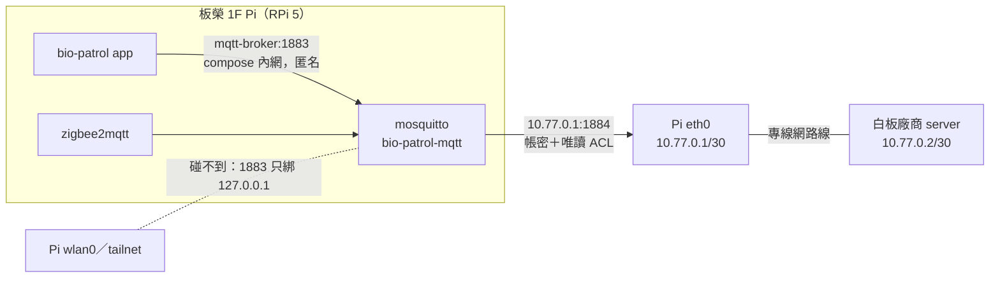

# 電子白板專線（板橋榮家 1F）

板榮 1F Pi 上實際採用的 broker 與網路設定（2026-10-22 上線）。只有這一站需要，
**共用的 `deploy/docker-compose.prod.yml` 不改**；在 Pi 的 `~/bio-patrol/` 手動套用。
topic／payload 契約見 [`docs/whiteboard-board-topic.md`](../../docs/whiteboard-board-topic.md)。

| 檔案 | Pi 上的位置 | 說明 |
|---|---|---|
| `mosquitto.conf` | `~/bio-patrol/mosquitto.conf` | 取代原本單一 listener 的設定 |
| `board.acl` | `~/bio-patrol/whiteboard/board.acl` | 廠商帳號 `whiteboard` 只能讀 `bio-patrol/board/#` |
| `board.passwd` | `~/bio-patrol/whiteboard/board.passwd` | **不入 repo**；帳密記在 `~/.config/sigma/ssh-targets.json` 板橋榮家1F/pi notes |

## 拓撲



## 1. compose：`mqtt-broker` 服務改兩行 ports、加兩個 mount

```yaml
  mqtt-broker:
    image: eclipse-mosquitto:2.0
    container_name: bio-patrol-mqtt
    restart: unless-stopped
    ports:
      - "127.0.0.1:1883:1883"     # 匿名內網 listener：只留 Pi 本機除錯用，wlan0/tailnet/eth0 專線都碰不到
      - "10.77.0.1:1884:1884"    # 電子白板廠商專線（eth0 靜態 IP），帳密＋唯讀 ACL
    volumes:
      - mosquitto-data:/mosquitto/data
      - ./mosquitto.conf:/mosquitto/config/mosquitto.conf:ro
      - ./whiteboard/board.passwd:/mosquitto/config/board.passwd:ro
      - ./whiteboard/board.acl:/mosquitto/config/board.acl:ro
```

app／z2m 走 compose 網路的 `mqtt-broker:1883`，不受 host 綁定改動影響。

## 2. 帳密檔

```bash
cd ~/bio-patrol
docker run --rm -it -v "$PWD/whiteboard:/w" eclipse-mosquitto:2.0 \
  mosquitto_passwd -c /w/board.passwd whiteboard      # 互動輸入密碼
sudo chown 1883:1883 whiteboard/board.passwd whiteboard/board.acl
sudo chmod 600 whiteboard/board.passwd whiteboard/board.acl
docker compose -f docker-compose.prod.yml up -d mqtt-broker
```

## 3. 網路：eth0 靜態專線（NetworkManager）

`/etc/NetworkManager/system-connections/whiteboard.nmconnection`（root 600）：

```ini
[connection]
id=whiteboard
uuid=ab6e397c-ce01-41b2-bfda-c96c383ffccf
type=ethernet
autoconnect-priority=100
interface-name=eth0

[ethernet]

[ipv4]
address1=10.77.0.1/30
method=manual
never-default=true

[ipv6]
addr-gen-mode=default
method=disabled

[proxy]
```

`never-default`：專線不搶預設路由，Pi 對外仍走 wlan0。

`/etc/NetworkManager/conf.d/90-whiteboard-carrier.conf`：

```ini
# 電子白板專線：廠商 server 關機/拔線時 eth0 仍保留 10.77.0.1，重開機後 docker 綁 IP 才不會失敗
[device-whiteboard]
match-device=interface-name:eth0
ignore-carrier=yes
```

`/etc/sysctl.d/90-whiteboard-nonlocal-bind.conf`：

```ini
net.ipv4.ip_nonlocal_bind = 1
```

`ip_nonlocal_bind`：開機時 docker 可能比 NM 先起，10.77.0.1 還沒掛上也能綁 1884。

## 4. 驗證

```bash
nmcli -g GENERAL.STATE,IP4.ADDRESS device show eth0        # 100 (connected) / 10.77.0.1/30
ping -c 3 10.77.0.2                                         # 廠商 server
docker exec bio-patrol-mqtt mosquitto_sub -h 127.0.0.1 -p 1883 \
  -t 'bio-patrol/board/#' -v -W 3 --retained-only           # 目前 retained 的各床狀態
```

app 端另需在 `data/config/settings.json` 設 `whiteboard_enabled: true`、
`whiteboard_site_id: "banqiao-1f"`，然後重啟 app 容器（避開每晚巡房時段）。
