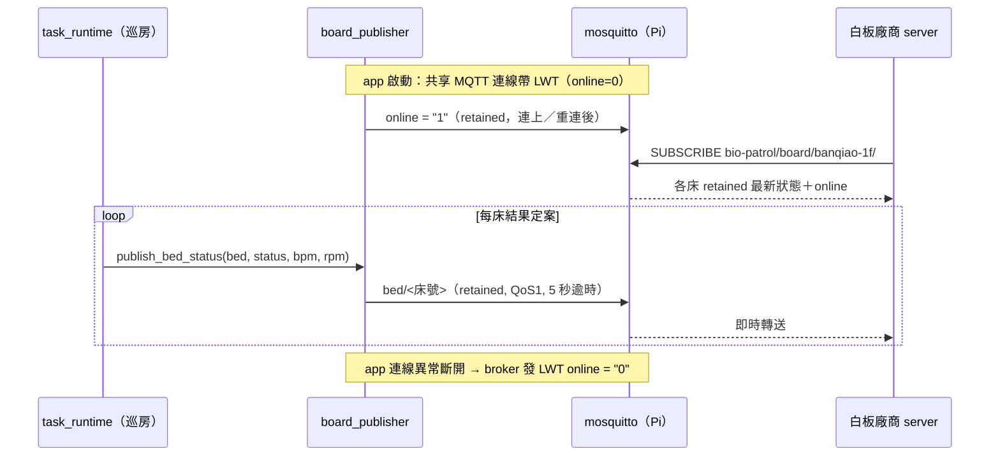

# 電子白板 MQTT 契約（IT-25）

板橋榮家 1F 的電子白板廠商 server 訂閱 Pi 上的 mosquitto，取得每床最新量測狀態。
bio-patrol 在**每床結果定案時**即時 publish 一筆 retained 訊息；沒有快照 API、
沒有 outbox，廠商任何時候連上來都能從 retained 訊息拿到每床最新狀態。

實作：`src/backend/services/integration/board_publisher.py`；
Pi 端 broker／網路設定：[`deploy/whiteboard/README.md`](../deploy/whiteboard/README.md)。

## 流程



## Topic

| Topic | 內容 | retained | QoS |
|---|---|---|---|
| `bio-patrol/board/<site>/bed/<bed>` | 單床結果 JSON | 是 | 1 |
| `bio-patrol/board/<site>/online` | `"1"`／`"0"`（純字串，非 JSON） | 是 | 1 |

- `<site>` = settings `whiteboard_site_id`（板榮 1F 為 `banqiao-1f`）。
- `<bed>` = 巡房床號（如 `101-1`）；若 `whiteboard_bed_id_map` 有對應則換成廠商床號，
  topic 與 payload 的 `bed` 一起換。

## Payload

固定五個欄位，不多給：

```json
{"bed": "101-1", "time": "2026-10-13T22:41:03+08:00", "bpm": 58, "rpm": 13, "status": "normal"}
```

| 欄位 | 型別 | 說明 |
|---|---|---|
| `bed` | string | 床號（已套用 bed map） |
| `time` | string | 結果定案時間，ISO 8601 含時區、秒精度無小數（站點 `timezone`，預設 Asia/Taipei） |
| `bpm` | int \| null | 心跳；只有 `normal`／`restless` 有值 |
| `rpm` | int \| null | 呼吸；只有 `normal`／`restless` 有值 |
| `status` | string | 下表五值之一 |

## status 五值

與 Telegram 巡房摘要同一套分類規則（`classify_scan`；摘要把 `absent` 併在「無讀值」）。

| status | 來源 | bpm／rpm |
|---|---|---|
| `normal` | 有效讀值（Wisleep status 4，且 bpm、rpm > 0） | 有值 |
| `restless` | 最後一筆 status 2（躁動，讀值不穩定） | 有值（最後一筆的讀值） |
| `absent` | 最後一筆 status 0（偵測不到人） | null |
| `unreachable` | 這床被跳過：走不到床邊、失聯／低電／貨架掉落整批跳過、兩度被誤判掉落訊號中斷 | null |
| `no_reading` | 其他：重試耗盡無有效讀值、感測器整段沒回、量測本身出錯（如 DB 寫入失敗） | null |

不推的情況：
- demo 巡房（`mode == "demo"`）一律不推，不論 `demo_synthetic`。
- 量測途中被貨架掉落切斷的那床，量測本身不推；它隨後走跳過路徑推 `unreachable`。
- 低電中止 → 被切斷量測的**當床與其後的床都不推**（量測直接結束、巡房隨即收工，不走跳過路徑），白板保留它們上一次的 retained 值。
- 手動取消／感測器靜默收工 → **其後沒跑到的床不推**，白板保留上一次的 retained 值；已量完的那床照常推（感測器靜默收工的觸發床推 `no_reading`；手動取消不會中斷進行中的量測窗，那床量完照推）。

## retained 語意

- 每床只保留最新一筆；廠商連上即收到全部床的最新狀態，不需要另外的快照 API。
- 舊的床號（改床號、撤床、測試樣本）會一直留在 broker，要手動清（見下方）。
- `time` 是判斷新舊的依據：今晚沒巡到的床，`time` 會停在上一次巡房。

## online／LWT

- app 的共享 MQTT 連線（ZigbeeMQTT，`zigbee_enabled=true` 時存在）連上並訂閱後 publish `"1"`；
  連線帶 LWT `"0"`（retained, QoS1），Pi 斷電、容器被殺、網路斷時由 broker 代發。
- 正常停止容器是乾淨斷線，broker **不發** LWT；所以 app 關閉時（`ZigbeeMQTT.stop()`）自己先 publish 一次 `"0"`（retained, QoS1，最多等 2 秒，失敗只 WARN）。
- `zigbee_enabled=false` 的站點沒有共享連線：每床 publish 改用短連線，**沒有 online topic**。

## 設定（`data/config/settings.json`）

| key | 預設 | 說明 |
|---|---|---|
| `whiteboard_enabled` | `false` | 站點開關；只有板榮 1F 開 |
| `whiteboard_site_id` | `""` | topic 的 `<site>`；空＝不推（開關開著會 WARN 一次） |
| `whiteboard_bed_id_map` | `{}` | 巡房床號 → 廠商床號，如 `{"101-1": "A01"}`；沒列的原樣 |

每床 publish 會讀當下設定；但 LWT／online 綁在啟動時建立的連線上，
**改開關或 site id 要重啟 app 容器**才完整生效（避開每晚巡房時段）。

## 失敗處理

絕不阻塞、絕不炸巡房：單次 publish 5 秒逾時，失敗只記一行 WARNING，不重試、不排隊。
貨架掉落整批跳過時各床並行 publish，broker 掛掉最多多花一次逾時。

## Broker（Pi）

- 第二個 listener `10.77.0.1:1884`（eth0 專線，廠商 server 10.77.0.2/30），
  `allow_anonymous false`，帳號 `whiteboard`，ACL 只能讀 `bio-patrol/board/#`。
- 匿名 listener 1883 只綁 `127.0.0.1`（compose 內網照舊走 `mqtt-broker:1883`）。
- Pi 的 compose 已改綁上述 ports；共用的 `deploy/docker-compose.prod.yml` 不動。

## 清除 retained 樣本

送空訊息（`-n`）加 retain（`-r`）即刪除該 topic 的 retained 訊息：

```bash
# 看目前 retained 的內容
docker exec bio-patrol-mqtt mosquitto_sub -h 127.0.0.1 -p 1883 \
  -t 'bio-patrol/board/#' -v -W 3 --retained-only

# 刪單床
docker exec bio-patrol-mqtt mosquitto_pub -h 127.0.0.1 -p 1883 \
  -t 'bio-patrol/board/banqiao-1f/bed/101-5' -r -n
```
